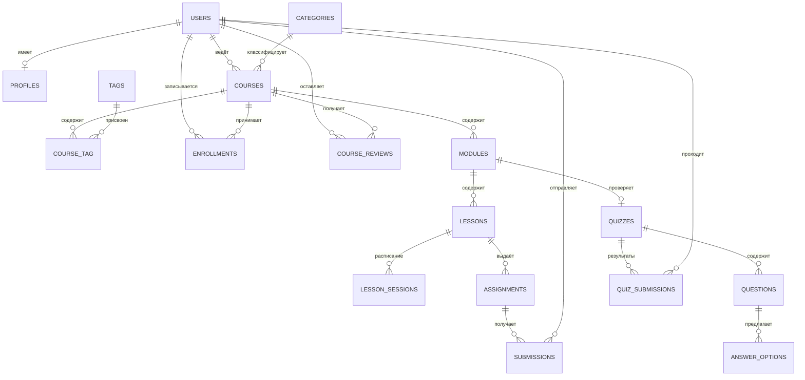

# Учебная платформа «Практикум ORM»

Платформа хранит курсы, уроки, расписание и задания. Студент записывается на курс, сдаёт работу и проходит тест. Преподаватель выставляет балл и оставляет комментарий. Проект демонстрирует связи JPA, каскадные операции и работу с ленивой загрузкой.

**Стек** — Java 17+, Spring Boot 3.5.15, Spring Data JPA, Hibernate, PostgreSQL 16, Maven. Веб-интерфейс работает на HTML, CSS и JavaScript.

## Запуск и проверка

Понадобятся Git, JDK 17+, Maven 3.9+, Docker с Compose v2 и PowerShell 7. Запустите Docker перед началом. Команды выполняются из корня проекта, кроме самого клонирования. Для запуска с уже установленной PostgreSQL есть отдельный раздел ниже.

### 1. Клонирование

Откройте PowerShell в папке, куда хотите скачать проект.

```powershell
git clone https://github.com/AbyanovDamir/orm-platform.git
Set-Location orm-platform
```

Если проект получен архивом, распакуйте его и откройте PowerShell в каталоге `orm-platform`, где лежит `pom.xml`. Продолжите со сборки.

### 2. Сборка

```powershell
java -version
mvn -version
docker compose version
mvn clean package -DskipTests
```

Ожидаемый результат — `BUILD SUCCESS` и файл `target/orm-platform-1.0.0.jar`. Пропуск тестов на этом шаге позволяет запустить их отдельно на шаге 4. Docker соберёт свой JAR внутри образа, как указано в `Dockerfile`.

### 3. Запуск приложения

При первом запуске создайте `.env` из примера. Если файл уже существует, используйте его. Значение `DB_PASSWORD` можно изменить перед первым запуском пустой базы.

```powershell
if (-not (Test-Path .env)) { Copy-Item .env.example .env }
docker compose up --build -d
docker compose ps
docker compose logs -f app
```

Дождитесь строки `Started PlatformApplication`, затем нажмите **Ctrl+C**, чтобы закрыть просмотр логов. Контейнеры продолжат работать. Откройте [http://localhost:8080](http://localhost:8080). На странице должен появиться курс «Основы Hibernate». PostgreSQL слушает порт `5432` на локальном интерфейсе, приложение — порт `8080`. Оба порта должны быть свободны перед запуском.

### 4. Автоматические тесты

Быстрый прогон на H2:

```powershell
mvn verify
```

Для прогона на PostgreSQL оставьте Compose запущенным и создайте отдельную базу `platform_test`. Если она уже есть, шаг создания можно пропустить.

```powershell
docker compose exec -T postgres createdb -U platform platform_test
$env:TEST_DB_URL = 'jdbc:postgresql://localhost:5432/platform_test'
$env:TEST_DB_USER = 'platform'
$env:TEST_DB_PASSWORD = Read-Host 'Введите DB_PASSWORD из файла .env' -MaskInput
mvn verify
Remove-Item Env:TEST_DB_URL, Env:TEST_DB_USER, Env:TEST_DB_PASSWORD
```

Профиль `test` пересоздаёт схему в указанной базе. Для ручных сценариев приложение продолжает использовать базу `platform`. Ожидаемый итог обоих прогонов — `Tests run: 19, Failures: 0, Errors: 0, Skipped: 0` и `BUILD SUCCESS`. Подробные отчёты лежат в `target/surefire-reports/`. GitHub Actions выполняет этот же набор на PostgreSQL 16 при push и pull request.

### 5. Ручное тестирование

Выполняйте браузерный сценарий на свежих демоданных. Если Анна уже сдавала работу, для точного повтора используйте очистку с удалением данных на шаге 6, затем повторите запуск.

#### Проверка в браузере

| № | Действие | Ожидаемый результат |
| --- | --- | --- |
| 1 | На главной странице выберите «Основы Hibernate» и Алексея Орлова. | Показаны два модуля, занятие, оценка `9 / 10` и предыдущий результат теста `2 / 2`. |
| 2 | Переключитесь на Анну Белову и нажмите «Записаться на курс». | Появляется статус «Вы записаны», поле для решения и кнопка «Открыть тест». |
| 3 | Введите текст решения в задании «Связь курса и модуля» и нажмите «Отправить решение». | Появляется статус «Решение отправлено» и текст работы. После обновления страницы работа видна. |
| 4 | Откройте «Демо · выставить оценку». Попробуйте ввести `11`, затем введите `8` и комментарий «Проверено». | Интерфейс отклоняет `11`. После сохранения допустимого значения отображаются `8 / 10` и комментарий. |
| 5 | Во втором модуле откройте тест. Выберите `@Id`, а во втором вопросе — «Запрос с EntityGraph» и «JPQL с JOIN FETCH». Отправьте ответы. | Отображается результат `2 / 2`. После обновления страницы последняя попытка видна в модуле. |
| 6 | Нажмите «Отписаться». | Появляется кнопка записи. Решение, оценка и последняя попытка остаются на странице. |

Выбор студента и демонстрационная форма оценки имитируют роли. Пользовательские сессии и вход по паролю в учебной версии отсутствуют.

#### Проверка REST API в PowerShell 7

Команды можно выполнять после браузерного сценария. Они находят курс по названию и создают нового студента с уникальным адресом, поэтому подходят и для повторного запуска.

**5.1. Чтение курса и создание студента**

```powershell
$api = 'http://localhost:8080/api'
$course = (Invoke-RestMethod "$api/courses") |
    Where-Object title -EQ 'Основы Hibernate' | Select-Object -First 1
$detail = Invoke-RestMethod "$api/courses/$($course.id)"
$detail.modules | ForEach-Object { $_.module.title }

$userBody = @{
    name = 'REST Student'
    email = "rest-$([guid]::NewGuid())@example.org"
    role = 'STUDENT'
} | ConvertTo-Json
$created = Invoke-WebRequest "$api/users" -Method Post -ContentType 'application/json' -Body $userBody
$created.StatusCode
$student = $created.Content | ConvertFrom-Json
```

Ожидаются названия «Модель данных», «Ленивая загрузка» и код `201` при создании студента.

**5.2. Запись на курс, повторная запись и ошибки API**

```powershell
$enrollment = "$api/courses/$($course.id)/enrollments/$($student.id)"
(Invoke-WebRequest $enrollment -Method Post).StatusCode
(Invoke-WebRequest $enrollment -Method Post -SkipHttpErrorCheck).StatusCode
(Invoke-RestMethod "$api/users/$($student.id)/enrollments") | Format-Table courseTitle, status

(Invoke-WebRequest "$api/courses/9223372036854775807" -SkipHttpErrorCheck).StatusCode
(Invoke-WebRequest "$api/users" -Method Post -ContentType 'application/json' -Body '{}' -SkipHttpErrorCheck).StatusCode
```

Ожидаются `201` при первой записи, `409` при повторной, одна запись со статусом `ACTIVE`, `404` для отсутствующего курса и `400` для пустого тела пользователя.

**5.3. Обновление и удаление данных ручной проверки**

```powershell
$updatedBody = $userBody | ConvertFrom-Json
$updatedBody.name = 'REST Student Updated'
$updatedJson = $updatedBody | ConvertTo-Json
(Invoke-RestMethod "$api/users/$($student.id)" -Method Put -ContentType 'application/json' -Body $updatedJson).name
(Invoke-WebRequest $enrollment -Method Delete).StatusCode
(Invoke-WebRequest "$api/users/$($student.id)" -Method Delete).StatusCode
(Invoke-WebRequest "$api/users/$($student.id)" -SkipHttpErrorCheck).StatusCode
```

Ожидаются новое имя, два ответа `204` и `404` после удаления пользователя.

### 6. Остановка и очистка

Остановить и удалить контейнеры проекта, сохранив данные PostgreSQL:

```powershell
docker compose down
mvn clean
```

Начать с чистых демоданных можно, удалив том PostgreSQL и локальный образ приложения. Эта команда удаляет **все** данные PostgreSQL данного Compose-проекта, включая ручные работы и тестовую базу:

```powershell
docker compose down --volumes --rmi local
mvn clean
```

Для нового запуска повторите шаг 3. После удаления тома приложение создаст схему и демоданные при старте.

## Запуск с установленной PostgreSQL

В интерактивном `psql` от администратора базы создайте роль и базу:

```sql
CREATE ROLE platform LOGIN;
\password platform
CREATE DATABASE platform OWNER platform;
```

Из корня проекта после сборки выполните:

```powershell
$env:DB_PASSWORD = Read-Host 'Пароль роли platform' -MaskInput
$env:DEMO_DATA = 'true'
java -jar target/orm-platform-1.0.0.jar
```

По умолчанию используется `jdbc:postgresql://localhost:5432/platform` и роль `platform`. Для другой конфигурации задайте `DB_URL` и `DB_USER`. Профиль `dev` создаёт схему через Hibernate. При повторном запуске загрузчик проверяет наличие демо-преподавателя. Приложение можно остановить сочетанием **Ctrl+C**.

На Windows при ошибке Tomcat `Unable to establish loopback connection` запустите JAR на JDK 17 с командой ниже. Путь `no-socket-dir` должен отсутствовать.

```powershell
java "-Djdk.net.unixdomain.tmpdir=$PWD/no-socket-dir" -jar target/orm-platform-1.0.0.jar
```

## Модель и правила

В модели 16 JPA-сущностей и 17 таблиц. Имена таблиц приведены ниже. Поля времени занятий и попыток хранятся как `Instant`. Дедлайн действует включительно по дате UTC. `timeLimit` задаёт рекомендуемую длительность теста в минутах. Для каждого вопроса нужно выбрать ответ. Балл начисляется за точное совпадение набора выбранных вариантов с ключом. Повторные попытки сохраняются отдельно.



- `Profile → User` и `Quiz → CourseModule` защищены уникальными внешними ключами. `Course ↔ Tag` использует `@ManyToMany` через `course_tag`.
- `Enrollment` хранит статус и дату записи. Пары «курс + студент», «задание + студент» и «курс + автор отзыва» уникальны в базе.
- Удаление курса каскадно удаляет его модули, уроки, занятия, задания, решения, тесты, попытки, записи и отзывы. Категория, преподаватель и теги остаются. При попытке удалить используемый справочник API возвращает конфликт.
- Набор вопросов создаётся вместе с тестом. После создания можно редактировать название и рекомендуемую длительность. Студенческий ответ API содержит формулировки и варианты без ключа.

## REST API

Базовый префикс — `/api`. Тело передаётся как JSON. Создание возвращает `201`, удаление — `204`. Ошибки возвращаются как `application/problem+json` с текстом в `detail` и, при проверке полей, списком `errors`.

| Ресурс | Операции |
| --- | --- |
| `/users`, `/categories`, `/tags`, `/courses` | `GET` списка, `POST` создания, `GET/PUT/DELETE /{id}` |
| `/users/{id}/profile` | `GET`, `PUT` для создания и обновления, `DELETE` |
| `/courses/{id}/modules` | `POST` для добавления модуля |
| `/modules/{id}/lessons` | `POST` для добавления урока |
| `/lessons/{id}/sessions`, `/lessons/{id}/assignments` | `POST` для создания занятия и задания |
| `/modules/{id}`, `/lessons/{id}`, `/sessions/{id}`, `/assignments/{id}` | `GET/PUT/DELETE` |
| `/courses/{id}/enrollments`, `/users/{id}/enrollments` | `GET` записей |
| `/courses/{id}/enrollments/{studentId}` | `POST` записи, `DELETE` отписки |
| `/courses/{id}/enrollments/{studentId}/completion?teacherId=…` | `PUT` для завершения курса |
| `/assignments/{id}/submissions` | `GET` решений, `POST` для сдачи работы |
| `/users/{id}/submissions` | `GET` работ студента |
| `/submissions/{id}/grade` | `PUT` оценки |
| `/modules/{id}/quiz` | `POST` теста с вопросами и вариантами |
| `/quizzes/{id}` | `GET/PUT/DELETE` |
| `/quizzes/{id}/attempts` | `POST` ответов, `GET` истории попыток |
| `/users/{id}/quiz-attempts` | `GET` результатов студента |
| `/courses/{id}/reviews` | `GET` отзывов, `POST` для студента, завершившего курс |

Примеры тел запросов. Используйте идентификаторы из ответов вашей базы.

```text
POST /api/users
{"name":"Иван","email":"ivan@example.org","role":"STUDENT"}

POST /api/courses
{"title":"JPA","description":"Связи ORM","categoryId":1,"teacherId":1,"duration":"2 недели","startDate":"2030-09-01","tagIds":[1]}

POST /api/assignments/1/submissions
{"studentId":2,"content":"Внешний ключ хранится в таблице модулей."}

PUT /api/submissions/1/grade
{"teacherId":1,"score":9,"feedback":"Добавьте пример mappedBy."}

POST /api/modules/1/quiz
{"title":"Первичный ключ","timeLimit":5,"questions":[{"text":"Аннотация ключа?","type":"SINGLE_CHOICE","options":[{"text":"@Id","correct":true},{"text":"@Table","correct":false}]}]}

POST /api/quizzes/1/attempts
{"studentId":2,"answers":{"1":[1]}}
```

## Архитектура и ленивая загрузка

- `entity` содержит модель и ограничения БД. `repository` предоставляет 16 Spring Data JPA-репозиториев и запросы для выборочной загрузки.
- `service` отвечает за бизнес-правила, границы транзакций и сборку DTO. `web` валидирует входные данные и преобразует исключения в HTTP-ответы.
- `spring.jpa.open-in-view=false`. В интеграционном тесте обращение к `modules` после обычного `findById` и закрытия сессии вызывает `LazyInitializationException`. Другой тест загружает модули через `@EntityGraph`, JPQL `JOIN FETCH` и доступ внутри транзакции.
- При чтении курса `@EntityGraph` заранее загружает модули, категорию и преподавателя. Сервис читает вложенные коллекции внутри транзакции и строит DTO. Hibernate пакетно загружает коллекции, нужные этому сценарию.

## Что покрывают тесты

15 интеграционных тестов проверяют схему, CRUD, каскадное удаление, уникальность записи, дедлайн, сдачу и оценивание работ, прохождение теста, отзывы, HTTP-валидацию и поведение LAZY. Четыре модульных теста проверяют правила начисления баллов. При локальной проверке все 19 тестов прошли на H2 2.3.232 и PostgreSQL 16.9.

## Публикация для сдачи

### Проверки и доставка сборки

Workflow [Verify and deliver](https://github.com/AbyanovDamir/orm-platform/actions/workflows/ci.yml) запускает тесты на PostgreSQL 16, проверяет исходный и тестовый код через Checkstyle и проверяет запуск демопроекта через Docker Compose. После успешной сборки JAR доступен в разделе Artifacts у запуска workflow.

При отправке тега с префиксом `v`, например `v1.0.0`, workflow публикует образ в GitHub Container Registry после прохождения обеих проверок. У образа будет тот же тег, например `ghcr.io/abyanovdamir/orm-platform:v1.0.0`. Доступ к скачиванию регулируется видимостью пакета на GitHub.

Распакуйте проект и отправьте содержимое каталога `orm-platform` в свой публичный GitHub-репозиторий. Проверьте выполнение workflow `Verify` и передайте ссылку через форму сдачи.
